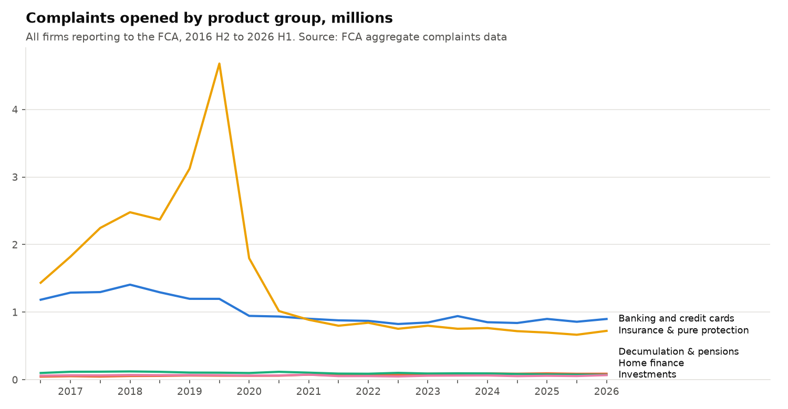
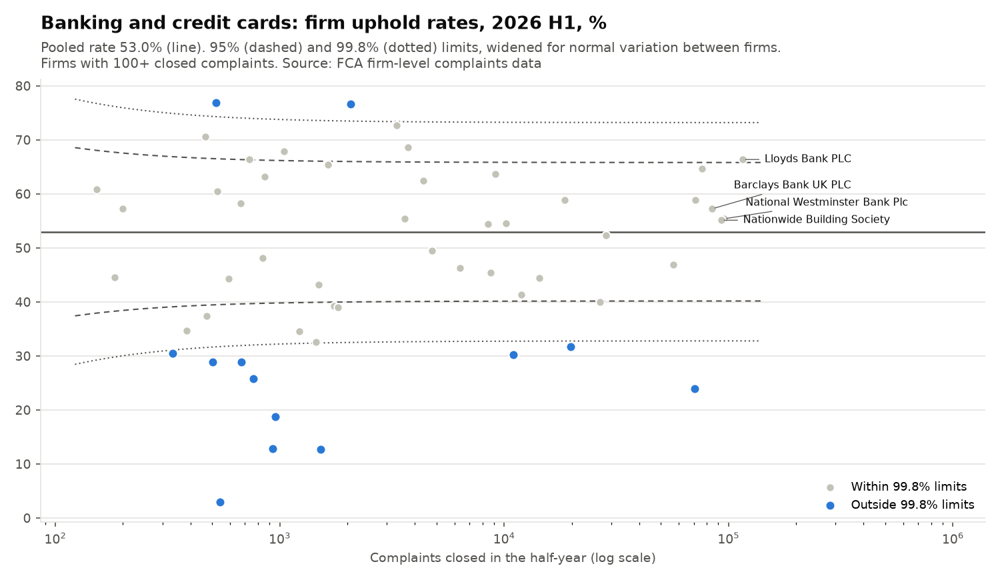
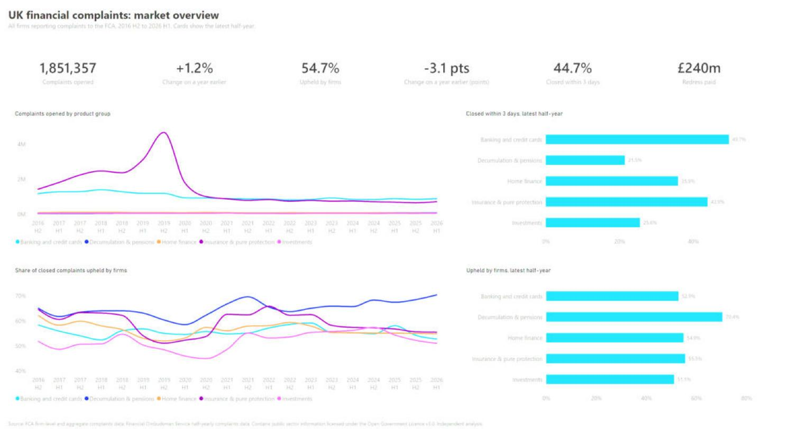
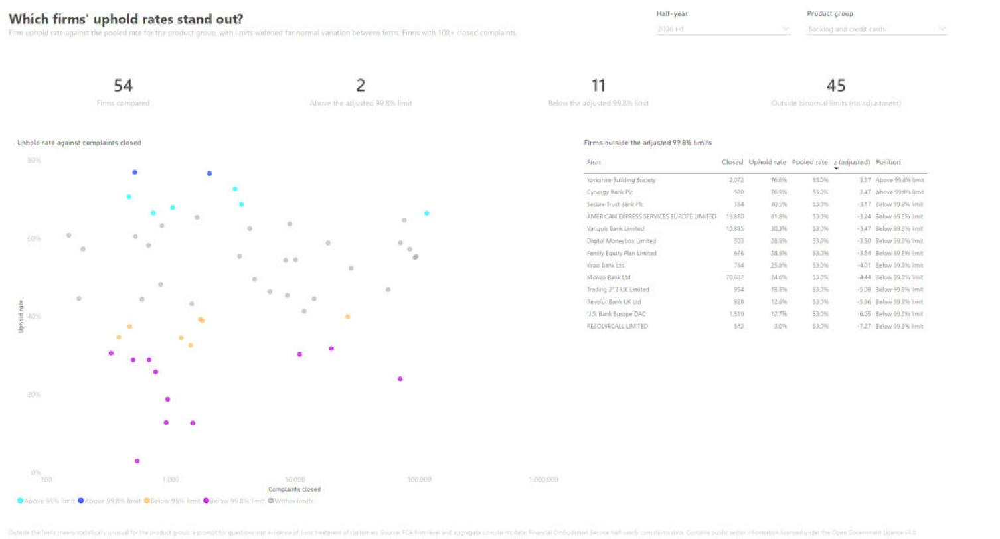
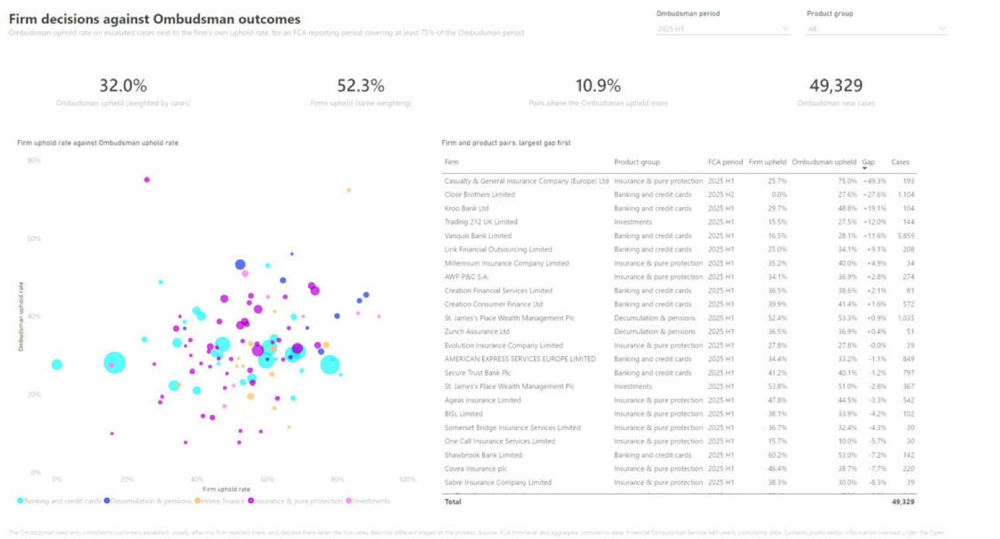

# UK Financial Complaints Monitor

[](https://github.com/geraltofrivia17/uk-financial-complaints-monitor/actions/workflows/ci.yml)

**Python · SQL Server (T-SQL) · Power BI (DAX, PBIP) · pytest · GitHub Actions**

Complaints reporting for UK financial services, built from the public complaints data published by the Financial Conduct Authority (FCA) and the Financial Ombudsman Service. Twenty half-years of releases (2016 H2 to 2026 H1) are loaded into a SQL Server warehouse, checked, and reported in Power BI. The analysis asks three questions a complaints or conduct-risk team would ask:

1. How are complaint volumes, uphold rates and handling times moving, by product?
2. Which firms' uphold rates stand out from their peers once firm size and normal variation between firms are allowed for?
3. When customers take a complaint to the Ombudsman, how do its outcomes compare with the firm's own decisions?

> Independent analysis of published data. Not produced by, or endorsed by, the FCA or the Financial Ombudsman Service. A firm appearing as unusual here is a prompt for questions, not evidence of poor treatment of customers.



## Key findings

**Market (2026 H1, all firms reporting to the FCA)**
- Firms opened **1.85 million** complaints, against 1.83 million a year earlier. Volumes peaked at **6.1 million in 2019 H2**, the last half-year before the PPI claims deadline, and redress paid peaked at **£2,755m** in 2019 H2. In 2026 H1 firms paid £240m.
- Firms upheld **54.7%** of the complaints they closed, down from 57.9% a year earlier.
- **44.7%** of complaints were closed within three days and 5.5% took longer than eight weeks.
- Pensions and decumulation complaints were the most often upheld (70.4%) and the slowest to resolve: 21.5% closed within three days, against 49.7% for banking and credit cards.

**Firms (2026 H1, 226 firms in the FCA's firm-level tables)**
- Ten firms received **48%** of the complaints in the firm-level tables. The largest were Lloyds Bank PLC, Nationwide Building Society and National Westminster Bank Plc.
- On standard binomial limits, **243 of 300** firm and product combinations look unusual. That says more about the method than the firms: with tens of thousands of complaints, the limits become very narrow and ignore the real differences between firms' customers and products. After allowing for that variation (an overdispersion adjustment), **41** stand out: 4 above the expected uphold rate and 37 below it.

**Firms against the Ombudsman (2025 H1, 110 firm and product pairs)**
- On complaints escalated to it, the Ombudsman found for the consumer in **32.0%** of cases (weighted by cases), while the same firms had upheld **52.3%** of the complaints they closed. The Ombudsman upheld a higher share than the firm in 11% of pairs.
- The two rates are only weakly related (correlation 0.23): a firm's own uphold rate says little about how its decisions fare when challenged.
- These are different stages of the process. The Ombudsman sees only the complaints customers chose to escalate, usually after the firm rejected them, so a lower Ombudsman rate does not mean firms are too generous. The comparison flags firms whose escalated cases go against them unusually often.



## Power BI report

`powerbi/ComplaintsMonitor.pbip` is a Power BI project: the semantic model is stored as TMDL and the report as PBIR, so every measure, relationship and visual is readable text under version control. It imports from the SQL Server reporting views and has five pages:

| Page | What it shows |
|---|---|
| Market overview | Latest half-year KPIs with change on a year earlier; complaints and uphold rates by product group since 2016 H2 |
| Firm benchmarking | Funnel plot of firm uphold rates for a chosen half-year and product group, and the firms outside the adjusted limits |
| Firms vs Ombudsman | Firm uphold rates against Ombudsman outcomes, with the largest gaps |
| Firm profile | One firm's complaints, uphold rates and reporting periods over time |
| Data quality | The build's data-quality checks and firm-level coverage of the market |

The DAX measures (35, in display folders) recompute every rate from counts, and the "selected half-year" measures follow the page's period and default to the latest one.







## What is in the repository

| Layer | What it does |
|---|---|
| **Python ingestion** ([src/complaints_monitor](src/complaints_monitor)) | Downloads and parses 20 FCA firm-level releases, 9 FCA market-total releases and 20 Ombudsman releases. The layouts changed many times: sheets renamed and reordered, header rows moved, a sheet whose columns are shifted against its header, upheld figures published as shares in some years and counts in others. Every row realigned and every value set aside is logged (196 entries in [issues.csv](data/processed/issues.csv)). |
| **Firm identity** | 636 firms across 8,133 firm, product and period rows. Names are normalised, so the 79 firms whose name was spelt in more than one way (case, punctuation, "Ltd" or "Limited") count once, and the 11 firms that changed name (for example Advanced Payment Solutions to Zempler Bank) are joined using the FCA reference number. |
| **FCA to Ombudsman matching** | 466 Ombudsman business names are linked to FCA firms by normalised name, covering 83.9% of Ombudsman cases. Fuzzy matching offered 34 further pairs; 33 were different firms with similar names (for example two insurers sharing "Insurance Company Limited"), so only reviewed pairs are used ([firm_map_review.csv](data/reference/firm_map_review.csv)). |
| **Data-quality checks** | 16 checks run on every build: 15 pass and 1 warn ([dq_checks.csv](data/processed/dq_checks.csv)). Firm-level complaints are 91.5% to 104.2% of the FCA's market totals across the 20 half-years. They are not expected to match: the market total covers over 3,000 firms and the firm tables only those above the publication threshold (226 in 2026 H1), reporting on their own financial half-years. |
| **SQL Server warehouse** ([sql/](sql)) | T-SQL star schema (dimensions for period, product group and firm; facts for firm complaints, consumer credit, market totals and Ombudsman outcomes), reporting views for Power BI, and SQL data tests. |
| **Analysis** ([analysis.py](src/complaints_monitor/analysis.py)) | Trends, funnel plots with overdispersion-adjusted limits, and the FCA to Ombudsman comparison. The same logic exists as SQL views, and a test checks the two give identical results. |
| **Power BI** ([powerbi/](powerbi)) | Power BI project (PBIP): semantic model in TMDL with DAX measures, and the report pages. |
| **Tests and CI** | pytest unit tests on small built workbooks, checks on the processed tables, and a GitHub Actions job that loads SQL Server 2022 in a container and runs the SQL data tests. |

## Method notes

- **Periods are stored as dates, never matched on labels.** The FCA's "H1" is January to June, but firms report on their own financial half-years, and each row keeps its own dates. The Ombudsman moved to April-to-September and October-to-March half-years in 2026, after a one-off nine-month period from July 2025 to March 2026. An Ombudsman period is compared with a firm's FCA period only when the FCA period covers at least 75% of it, so the nine-month period is not compared at all.
- **Rates are recomputed from counts.** Firm-level upheld counts are not published, so they are derived as the published rate times closed complaints. Derived upheld counts come to 93.6% to 102.5% of the published market totals in each half-year, a check on the derivation.
- **Scope starts in 2016 H2.** The FCA changed its complaints return on 30 June 2016 (new product groups, complaints closed within three days included). Earlier figures are not comparable and are not used.
- **Funnel limits.** Each firm's uphold rate is compared with the pooled rate for its product group. The adjusted limits add the between-firm variance estimated from winsorised z-scores (Spiegelhalter, 2005). Only firms with 100 or more closed complaints are included.
- **Market totals are revised.** Each FCA release restates about ten earlier half-years. The latest published figure is used, and every revision is kept ([fca_market_revisions.csv](data/processed/fca_market_revisions.csv)).

More detail: [methodology](docs/methodology.md), [data dictionary](docs/data_dictionary.md), [decision log](docs/decisions.md).

## Run it

Windows PowerShell, Python 3.13 and SQL Server (Express is enough):

```powershell
py -3.13 -m venv .venv
.\.venv\Scripts\Activate.ps1
python -m pip install -r requirements-dev.lock
python -m pip install -e . --no-deps

python -m complaints_monitor download   # the published files listed in config/sources.csv
python -m complaints_monitor build      # parse, link firms, run data-quality checks
python -m complaints_monitor load       # rebuild the SQL Server warehouse and run the SQL tests
python -m complaints_monitor analyse    # findings tables and charts
python -m complaints_monitor report     # this README, from the measured findings
pytest
```

The warehouse connection defaults to `localhost\SQLEXPRESS` with Windows authentication. To use another server, set the environment variable `COMPLAINTS_SQL_SERVER`, and for SQL authentication `COMPLAINTS_SQL_USER` and `COMPLAINTS_SQL_PASSWORD` ([.env.example](.env.example) lists them). Open `powerbi/ComplaintsMonitor.pbip` in Power BI Desktop and refresh; the server name is a parameter in Transform data > Edit parameters.

## Data sources and licence

- FCA [firm-level complaints data](https://www.fca.org.uk/data/complaints-data/firm-level) and [aggregate complaints data](https://www.fca.org.uk/data/complaints-data). Contains public sector information licensed under the Open Government Licence v3.0.
- Financial Ombudsman Service [half-yearly complaints data](https://www.financial-ombudsman.org.uk/data-insight/previous-complaints-data).

The raw files are not stored in the repository; `download` fetches them from the publishers. Code is under the MIT licence.

## Limitations

- Published data only: no information on individual complaints, their causes (beyond the FCA's product groups) or outcomes for customers.
- Firm-level tables cover firms above the FCA's publication threshold (500 complaints in a half-year or 1,000 in a year).
- The Ombudsman publishes uphold rates but not the number of resolved cases by business, so its rates are weighted by new cases when aggregated.
- Firm names are matched between the two publishers without a shared identifier. Exact normalised names are linked automatically and close names only after review; some links may still be missed.
